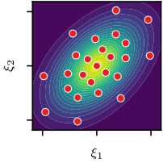
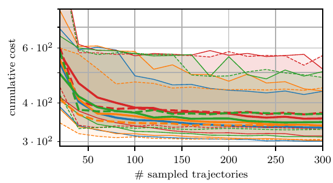
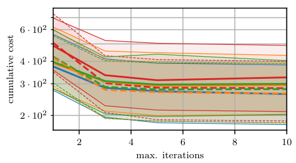
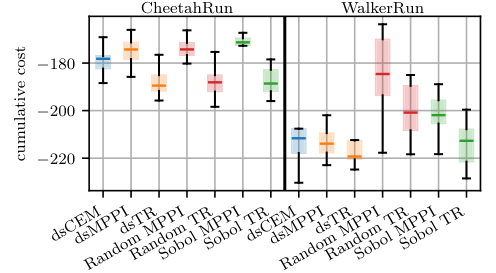
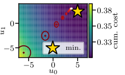
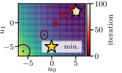

# 论文阅读报告：Sampling-based Model Predictive Control Using Trust Regions

## 0. 三分钟读懂

### 0.1 论文解决什么问题

采样式模型预测控制在每个周期生成许多未来控制序列，用模型预测后果，再提高低成本序列的采样概率。困难不只是样本数量：分布更新太激进会过早集中，太保守又来不及在有限次迭代内改善。常见实现用温度、动量等经验参数调节这种取舍。

本文提出信赖域模型预测控制（TR-MPC）：直接限制相邻两轮控制分布的变化，并可设置探索程度下限。它主要是一篇控制方法论文，辅以分布优化推导和仿真实验，不是接触规划理论或实机部署论文。

作者为 Markus Walker、Marcel Reith-Braun、Daniel Frisch、Uwe D. Hanebeck。所读版本为2026-09-22修订的arXiv v2；版本页注明已被CDC 2026接受。阅读日期为2026-11-16。实验均为作者报告；本轮完成原文审查与独立解析检查，没有重跑控制实验。

### 0.2 核心思路是什么

把“温度取多少”改写成“允许下一轮分布移动多远”。每轮采样并计算轨迹成本，再解一个只有两个变量的对偶问题，得到权重，以加权矩更新高斯分布。可选熵下界用于避免分布收缩过快。

第二层设计是局部累积分布（localized cumulative distribution，LCD）确定性采样：离线优化标准高斯代表点，在线旋转、缩放和平移。它改变样本覆盖；信赖域改变更新规则。组合方法称为dsTR，两层收益应分别归因。

### 0.3 最重要的结论与证据

最清楚的性能证据是倒车任务：每轮100个候选时，作者报告信赖域方案用3轮取得的成本，启发式方案用10轮仍未达到。证据是PDF第6页Fig.5(c)，不是形式化收敛率定理。主实验每设置100次运行，报告中位数与四分位区间。

收益有更新开销。**以PDF第6页Table I为准**：dsTR在摆杆上为 **201.8±55.7 ms/控制步**，dsMPPI为 **171.0±46.9 ms**；倒车分别为 **83.6±47.2 ms** 与 **69.1±42.2 ms**。均值开销约增加18.0%和21.0%，由原表均值计算，不是新实测。

这里存在千倍误读风险：HTML直接显示LaTeX输入值0.2018等，却仍标ms；源表使用siunitx固定指数转换，编译PDF显示201.8 ms。本报告采用PDF显示值。自动抓取的ar5iv缓存还缺少v2部分内容，详见第5章。

熵约束的直接机制证据是一个二维、100轮迭代的困难例子（Fig.3）；主基准中该约束多数时候作用很小。因此本文支持“探索保护必须是强对照”，并未研究恢复哪些旧控制时间块。

### 0.4 最终判断

**值得精读，并应成为本项目选择性重开研究的强基线。** 它提供明确的更新约束，并在不同采样器上控制变量比较。最大边界是理想密度优化与有限样本、固定相关高斯实现之间的距离。附录关于最优乘子始终非零的定理，还缺少排除平底最优集的条件。

对本项目，选择性重开必须证明其收益超过持续探索、标准差下限和熵保护，并改善完整任务，而非只降低失败checkpoint上的成本。

### 0.5 阅读路线

- 只想判断是否值得读：读本章和第4章。
- 想理解方法与公式：读第1–2章，必要时查附录B。
- 想判断证据强弱：读第3章与附录A。
- 想接入SMPC实验：读第5章；证据位置见附录D。

### 0.6 论文与链接

- 原始输入链接：https://arxiv.org/abs/2605.07801
- 最终使用的 arXiv 版本化 ID：2605.07801v2
- 原论文 arXiv 链接：https://arxiv.org/abs/2605.07801v2
- 幻觉翻译链接（hjfy）：https://hjfy.top/arxiv/2605.07801v2
- Cool Papers 链接：https://papers.cool/arxiv/2605.07801v2

## 1. 建立心智模型

### 1.1 用最小问题或具体例子说明研究对象

只优化未来两次推力：先向左蓄力，再向右把摆杆甩上去。候选是二维向量$\xi=[u_0,u_1]^\top$。高斯中心表示当前最愿意尝试的推力，协方差表示探索范围和相关性。

如果最初碰巧在错误区域找到略好的轨迹，交叉熵方法（CEM）可能围绕它们快速收缩。此后即使继续迭代，也难以采到另一处更好的控制。反过来，一直保持大扰动又会拖慢局部精修。

本文限制每次分布变化幅度，并可限制分布熵，保留搜索体积。它没有识别哪个时间段应恢复探索，也没有维护多个独立接触策略。控制周期之间的重规划，与同一周期中的多轮分布优化，是两个不同时间尺度。

### 1.2 核心结构或论证链

信息流为：当前状态和旧计划 → 产生未来控制序列 → 模型rollout及成本 → 解对偶、计算新权重 → 更新均值和边际方差 → 重复少量轮次 → 执行已评分最佳序列的第一个动作。下个周期将计划和缓存移位，继续优化。

LCD点集是可替换的采样器。下图为原文Fig.1(b)，展示标准代表点变换到非球形高斯后的覆盖。

点的排列解释覆盖质量，椭圆形状来自当前协方差。在线先随机旋转标准点，再缩放平移，不是每轮重复完全相同的控制候选。

方法不训练策略或动力学网络。需要可调用的预测模型和成本；梯度仅用于二维对偶求解，不需要对仿真器反传。

### 1.3 必要术语、定义与符号

| 术语 | 一句话解释 | 为什么必须知道 |
|---|---|---|
| MPC | 规划未来一段控制，执行首步，再观测重规划 | 区分控制周期与优化迭代 |
| $\xi\in\mathbb R^d$ | 控制序列拼接向量，$d=N_Hd_u$ | 分布定义在控制序列上 |
| $f_j$ | 第$j$轮候选控制概率密度 | 被更新的是采样分布 |
| $J(\xi)$ | 有限时域rollout成本 | 比较需同目标、同评价窗口 |
| KL散度 | 新分布相对旧分布的信息变化 | 本文方向为$D_{\rm KL}(f_{j+1}\|f_j)$ |
| 微分熵$H$ | 连续分布的扩散程度 | 依赖变量尺度及单位 |
| $\epsilon,H_{\min}$ | KL上界与熵下界 | 仍需选择的约束参数 |
| $\eta,\alpha$ | KL与熵约束的非负乘子 | 决定权重和展平程度 |
| $\mu_j,C_j$ | 高斯均值与协方差 | 实际固定相关性，仅更新边际方差 |
| dsTR | LCD采样配合TR更新 | 不能把组合收益全归给单层 |

原文相关工作也用$\alpha$表示动量；本报告公式中$\alpha$始终表示熵约束乘子。

### 1.4 与最接近工作的本质区别

作者前作dsCEM已提出LCD点集、在线变换和协方差结构；dsMPPI进一步结合指数软权重、动量和温度启发式。TR-MPC保留采样与工程路线，把权重参数选择改成受约束的对偶求解。新增重点是更新规则，不能把点集、缓存、时间相关性全部算成本篇原创。[dsCEM §IV](https://arxiv.org/html/2510.05706v2)，[dsMPPI §4](https://arxiv.org/html/2601.03893v2)。

更早的MORE在黑箱搜索中已使用新旧分布的KL约束与探索约束；它学习局部二次目标代理，以高斯解析形式更新。本文使用真实轨迹成本的采样近似，并组织为迭代MPC。因此限制搜索分布变化不是本文首次提出。[MORE §2](https://proceedings.neurips.cc/paper_files/paper/2015/file/36ac8e558ac7690b6f44e2cb5ef93322-Paper.pdf)。

iCEM通过相关噪声与精英记忆提高有限预算效果，是另一个必要对照；它没有本文对偶权重求解。[iCEM §3](https://arxiv.org/html/2008.06389v1)。这些来源用于辨认继承关系，不构成穷尽检索。

## 2. 核心思路如何成立

### 2.1 研究对象、输入输出与关键前提

输入包括当前状态$x_k$、可rollout的动力学、运行及终端成本、控制范围、旧高斯参数和缓存控制。把$N_H$步、每步$d_u$维控制展平，便可并行预测候选后果。目标仍是原文PDF式(1)的有限时域成本，没有学习损失。

输出是已评估最佳序列的首动作，不是未经rollout检验的高斯均值。但最佳样本也没有因此获得硬状态可行性或闭环稳定性保证。

理想优化对所有合适密度求解；实际实现限于高斯。一般非线性成本下，理想最优密度未必高斯，积分只能用样本估计，固定相关结构还会约束协方差表达。应依次区分“理想密度”“样本近似”和“实际高斯”。

### 2.2 核心机制、协议或论证链

先最小化下一密度下的期望成本，同时限制KL距离；可选熵下界防止探索体积过快消失。以拉格朗日乘子处理约束，对密度作变分，得到新的加权目标。

随后用旧候选估计归一化积分，求解$\eta,\alpha$两个标量。求解变量数不随控制维数增长，但密度计算、积分、矩更新和rollout代价仍随样本数与维数增长。

最后按权重更新均值和边际方差，重建固定时间相关协方差。采样可采用随机高斯、随机化Sobol/Halton或LCD；控制范围由裁剪处理。低成本序列缓存供下一轮使用，旧计划和缓存在下个控制周期移位热启动。

LCD离线优化标准高斯代表点$z_i$，在线变换为$\xi_i=\mu_j+L_jR_jz_i$，其中$C_j=L_jL_j^\top$，$R_j$为特殊正交旋转。标准高斯旋转不变性支持先旋转再缩放。有限确定性点集不是独立同分布随机样本，不能直接套用独立采样置信结论。

### 2.3 决定性公式、定理或算法（按需）

为避免略低成本的少量候选使分布骤缩，PDF式(5)规定可接受的下一密度$q$：

$$
\min_q\;\mathbb E_q[J(\xi)]\quad\text{s.t.}\quad D_{\rm KL}(q\|f_j)\le\epsilon,\quad H(q)\ge H_{\min},\quad\int q(\xi)\,d\xi=1.
$$

较小$\epsilon$只允许较小更新；$H_{\min}$限制总体探索体积。熵下界不保证每个坐标都有足够方差：某些方向可以很小，由其他方向补偿总熵。它更不会指定该扩大哪个时间块。

变分条件给出PDF式(7)：

$$
q^*(\xi)=\frac{1}{Z_{\eta,\alpha}}f_j(\xi)^{\eta/(\eta+\alpha)}\exp\!\left(-\frac{J(\xi)}{\eta+\alpha}\right).
$$

低成本提高密度；当$\alpha>0$时，旧密度指数小于1，有展平作用。需要归一化积分有限、$\eta+\alpha>0$；后一个条件的普遍性在C2及附录B审查。

为了用旧分布样本估计$q^*$，要除以采样密度。PDF式(10)的实际权重为：

$$
\widetilde w_i=f_j(\xi_i)^{-\alpha/(\eta+\alpha)}\exp\!\left(-\frac{J(\xi_i)}{\eta+\alpha}\right),\qquad w_i=\frac{\widetilde w_i}{\sum_\ell\widetilde w_\ell}.
$$

目标密度和样本权重中的旧密度指数不同，省掉密度比会实现另一算法。$\alpha=0$时退化为指数成本权重，温度由对偶决定；这不意味着$q^*$对一般成本保持高斯。

PDF式(8)–(9)将问题压缩为：

$$
\max_{\eta\ge0,\alpha\ge0}\;g(\eta,\alpha),\qquad g=-\eta\epsilon+\alpha H_{\min}-(\eta+\alpha)\log Z_{\eta,\alpha}.
$$

其中$Z=\mathbb E_{f_j}[\widetilde w]$。二维求解取代手动温度更新，没有取消$\epsilon,H_{\min}$等选择。原文梯度及强对偶前提见附录B。

均值更新为$\mu_{j+1}=\sum_iw_i\xi_i$，边际方差为$\sigma^2_{j+1,r}=\sum_iw_i(\xi_{i,r}-\mu_{j+1,r})^2$。§V-B明确固定时间相关性、只更新边际方差。它与G1现有完整协方差CEM表达能力不同，不能只替换名字比较。

### 2.4 假设、训练推理与实现边界

理论要求旧密度非退化、成本有合适下界、旧密度下期望成本有限，以及严格可行点。App.D选旧密度自身作为严格可行点，还依赖$\epsilon>0$且$H(f_j)>H_{\min}$；当前熵已低于固定下界时，不能直接使用这一步证明。

裁剪后的控制不再遵循原始高斯；若保留未裁剪变量作优化变量，把饱和放进动力学，可保留高斯密度解释。原文提到这种解释，本轮没有完整控制器代码可核对实际变量流。缓存点也不全来自当前$f_j$，它们与理想积分的对应需要实现审查。

方法没有训练阶段，推理不能看真实未来。MuJoCo是仿真验证，不是模型偏差、执行延迟、感知误差或实机接触承载的证据。本文未证明全局最优、闭环稳定或硬状态安全。

## 3. 证据是否成立

### 3.1 Claim—Evidence—Verdict 总表

| Claim | 原文位置 | 作者证据 | 支撑强度 | 最大缺口 | 本报告结论 |
|---|---|---|---|---|---|
| C1：约束化更新替代启发式温度/动量适配 | Abstract；§IV式(5)–(10)；App.A/B | 变分、二维对偶、样本权重 | 部分支撑 | 理想密度与有限样本及固定相关高斯有差距 | 支持明确的更新目标，不支持无调参或实现自动严格可行 |
| C2：强对偶成立，最优乘子和始终为正 | §IV；App.C Theorem 1；App.D | 强对偶条件与反证 | 部分支撑；Theorem 1按现有假设有反例 | 未排除平底最优集；一般成本下高斯性表述过宽 | 有条件接受强对偶；不接受定理无条件外推 |
| C3：少样本时成本更低、样本效率更好 | §VI-B；Fig.4(a)、5(a) | 每轮20–300样本、3轮、100次 | 部分支撑 | 无逐点原始数据或统一墙钟最优比较 | 支持所测设置的有限预算收益 |
| C4：更少迭代获得较低成本 | §VI-D；Fig.4(c)、5(c) | 100样本；1/3/5/10轮对比 | 部分支撑 | 有限设置经验结论，不是收敛率证明 | 倒车3轮对10轮证据最清楚 |
| C5：TR配合LCD可保留良好平滑性 | §VI-C；Fig.4(b)、5(b) | 动作变化平方和 | 部分支撑 | 随机/Sobol摆杆TR多数时候反而更不平滑 | 平滑收益需绑定采样策略 |
| C6：熵下界抑制长迭代过早塌缩 | §VI-A；Fig.3 | 二维100轮有/无熵对比 | 部分支撑 | 主基准作用小；单例不是高维全局保证 | 是必要探索保护对照 |
| C7：LCD与TR组合较强，并可用于更高维任务 | Contributions；§VI-F；Fig.4–6 | 采样器×更新；两项60维MuJoCo验证 | 部分支撑 | 环境和维度范围有限，未覆盖接触操作 | 支持所测范围，不支持维数无关优势 |
| C8：适合预算有限的在线/现实控制 | §VI-E；Table I；Discussion/Conclusion | 单CPU核时间和样本/迭代曲线 | 间接支撑 | 无实机、GPU预算曲线或严格实时截止实验 | 值得验证，不能直接推导G1实时可用 |

清单覆盖摘要、贡献与结论中的核心方法、理论、性能及应用主张。不需要动力学导数是第2章交代的输入条件，不另包装为实验贡献。每条Claim在附录D有独立定位。

### 3.2 主结果与决定性证据

主对照是具有缓存、热启动、时间相关与协方差更新的迭代MPPI式基线，不是最简单的单轮固定方差方法。同采样器实线/虚线较能识别更新规则增量。不过沿用前作参数不等于所有方法都有相同的最优调参机会。

| 问题 | 作者协议 | 决定性证据 | 支持的判断 |
|---|---|---|---|
| C3样本效率 | 3轮；20–300样本；两个任务 | Fig.4(a)、5(a)，尤其$N\le100$ | 多数低预算设置TR成本较低 |
| C4迭代效率 | 100样本；1/3/5/10轮 | §VI-D：倒车启发式10轮未达到TR 3轮成本 | 支持相同每轮样本数下的迭代收益 |
| C7高维补充 | CheetahRun、WalkerRun；6维×10步；100随机初态 | Fig.6箱线图，dsTR中位成本最低 | 拓展到60维优化，不是60个执行器 |

先比较同色实线与虚线，再比较颜色：dsTR是橙色虚线，dsMPPI是橙色实线，dsCEM为蓝色，Random为红色，Sobol为绿色。原文没有逐点数值表，本报告不把图形估读包装成精确提升百分比。

它直接服务C4：TR几轮内取得明显改善。横轴是优化轮数，不是墙钟时间，二维对偶开销仍须单列。

纵轴为负的累计成本，越低越好。不能把更负误读成更差，也不能把这两项跑步任务转换成机器人抓取成功率。

### 3.3 关键消融、证明与补充证据

**C6：熵保护的直接证据。** Fig.3比较dsCEM、dsMPPI、无熵dsTR和有熵dsTR。初始分布特意远离低成本区域，二维控制、$\epsilon=2$、有熵版本$H_{\min}=0$，运行100轮；每10轮画2σ椭圆。

看分布范围与终点，而非只看中心路径。作者用单例说明KL限制仍可能逐轮塌缩，熵保护可维持探索；没有跨初值和维度的系统成功率统计。主基准使用$H_{\min}=-50$时作者明确说其作用很小。

**C1：参数敏感性。** Fig.2固定100样本、5轮，扫描$\epsilon$，四种采样器在所测摆杆设置中均在2附近最好。更小半径需要更多轮，更大半径可能过冲。对偶求解减少一类启发式，没有免除约束尺度选择。

**C5：反向结果。** §VI-C承认，摆杆中随机与Sobol启发式基线在多数样本数下比对应TR更平滑；倒车低预算中TR更平滑；LCD组合大多相近或略优。这限制了“TR本身普遍改善平滑性”的因果说法。

**C8：额外计算。** Table I在单个Intel Xeon Platinum 8368核心测量。dsTR相对dsMPPI均值增加30.8 ms和14.5 ms，来自原表相减。原文未把所有方法统一到相同目标成本后测端到端时间，故更新较慢与达到同等质量可能更快需分开。

**C2：证明核查。** App.A/B建立变分与对偶链；App.D列出成本下界、旧期望有限、严格可行点。App.C把“非恒定”当成排除零乘子的充分条件，遗漏平底最优集；附录B给出连续目标反例。这限制定理，不否定全部仿真收益。

### 3.4 证据没有覆盖什么

C1/C2：没有证明有限样本、裁剪、缓存、固定相关高斯同时使用时，每一步严格满足理想约束。需测更新后的高斯KL、熵及估计误差。但理想完整矩匹配有继承约束的良好性质，见B3，不能笼统把问题归咎于所有高斯投影。

C3/C4：有100次运行和IQR，没有逐运行原始数据、配对区间或成功率—预算曲线。不能转换成项目预注册的成功率门槛或统计显著性。

C6/C7：二维长迭代例子与两个跑步任务没有覆盖渐进扩展时域、接触模式切换或冻结前段的可恢复性。“哪些旧变量值得恢复”仍是待验证研究问题，不能仅凭本文未讨论就宣称已证明新颖。

C8：没有GPU吞吐、实机延迟、感知或接触承载验证。Discussion的“32条可并行、33条可能翻倍”是条件性硬件例子，不是GPU实测结论。

## 4. 最终判断与适用边界

### 4.1 真正的新意

本文把信息约束思想接入采样式MPC，用轨迹成本的采样积分组织对偶权重，再比较同采样器的更新增量。与作者前作结合形成离线代表点＋在线约束更新的方法。价值是具体、可替换、可比较的更新机制，不是首次提出KL信赖域或首次处理搜索收缩。

对[本项目构想](../../03_CEM_IDEA_REVIEW.md)，可保留的窄问题是：后续目标或扩展时域暴露困难后，用真实干预收益选择恢复哪些收缩时间块。单纯增大方差、保持熵或宣称防塌缩不足以构成增量；是否胜过固定早段和随机等大小块，仍需同预算证据。

### 4.2 决策性问题（只引用 Claim ID）

1. C1、C2：实现前先核查权重和约束残差，不把定理直接当作接触优化保证。
2. C3、C4、C8：同时报告任务质量和实际计算量，不只按样本数宣布更快。
3. C5、C6：分别消融采样器、探索保护和选择规则。
4. C7：必须提供自己的完整接触与搬运任务证据。

### 4.3 学术位置与竞争路线

本文处于分布更新路线，承接MORE等信息约束搜索，并与iCEM、dsCEM、dsMPPI的有限预算设计相接。验证选择性重开不需要同时引入学习动力学、多高斯或接触图。

本项目Hydrax CEM已有更近的朴素强对照：num_explore以初始尺度在当前均值附近产生探索样本，sigma_min设置边际标准差下限。见[现有源码](../../../src/hydrax/hydrax/algs/cem.py)。即使旧G1实现会硬关闭低方差变量，也不能假设整个工作区只有这种基线。

### 4.4 是否值得精读或验证

- 阅读建议：精读§IV、§VI-A/D和App.C/D，分别理解更新、最强经验收益与理论范围。
- 复现/验证建议：先做最小密度更新核查和二维例子，再进入共用控制任务；本轮仅静态阅读与解析检查。
- 最适合的使用场景：已有rollout模型，少量迭代内需要比启发式权重更稳定的更新。
- 当前不应外推到：普遍全局收敛、严格接触可行、G1实机实时搬运、每个方向都保持探索或无调参控制。

## 5. 复现、验证与工程边界

### 5.1 复现资产、验证前提与开放材料

已取得版本化[PDF](raw/paper.pdf)、[摘要页](raw/abs.html)、[源码](cache/source_unpack/root.tex)、方法、实验、附录、参考文献及源图。复现需要动力学与成本实现、初始分布、采样器、参数、更新与统计协议，不需要训练数据或权重。

论文链接的[官方采样库](https://github.com/KIT-ISAS/deterministic_gaussian_sampling_py)提供高斯到Dirac代表点近似接口。本轮打开README和目录核对用途；它不是TR-MPC完整控制器。当前未找到并审查完整控制器，不能声称优化容差、失败回退、缓存密度或任务默认配置已逐行一致。

传统任务细节指向作者前作；本轮核对前作算法段落，没有把其所有参数自动移植为当前v2默认值。忠实复现仍需确认时域、成本、动作范围、缓存数、初始化、启发式温度及对偶求解器设置。离线点集计算与存储应登记并同在线延迟分列。

### 5.2 论文与代码、证明或协议的一致性

已读取PDF全部8页，结合源码核对公式、图注和表格。完成的是材料审查、精确源图定位、Hydrax CEM只读检查及解析推导，没有控制实验重跑或形式化证明。

metadata.json记录各入口HTTP 200，但hjfy只返回JavaScript页面壳，没有可读翻译；Cool Papers提供题录摘要，没有独立技术证据。raw/ar5iv.html缺少v2的MuJoCo与Luenberger内容；cache/references.json只有18项，v2 PDF及root.bbl为21项。因此本报告以版本化PDF和对应源码为准，抓取成功不等于版本一致。

自动图片manifest第8项目标是cart-pole成本图，却因重名匹配成truck源图。本报告未使用figure_08.png；正文摆杆图由精确源路径重新渲染为cartpole_sample_cost_verified.png，原manifest保留以暴露问题。其他图片均对照源文件和PDF图号，未将自动子图caption当作事实。

时间值采用编译PDF的ms显示值，公式编号也以PDF为准。源表输入数值、格式宏及HTML呈现不能直接互换。

### 5.3 成本、风险与最小验证路径

第一步在一维或二维已知成本上核查对偶、权重、乘子和、更新后的解析高斯KL与熵。分别关闭裁剪、缓存和固定相关性，再逐项打开，识别理想目标与实现的差距。无需G1或GPU。

第二步按Fig.3比较有/无熵约束，检查平底成本和近零乘子时求解器是否稳定；再在一个传统控制任务上比较同采样器的启发式与TR。使用自选配置的原型不称为原论文完整复现。

第三步接入SMPC共用任务，固定机器人、cost、控制表示、时域和输出选择，比较旧搜索、Hydrax式持续探索及标准差下限、全局重开、固定/随机块、真实试探选块与TR保护。试探、插值、更新、传输和额外求解全部计入world-steps及墙钟。

失败checkpoint只判断局部修复；完整研究还要从相同初态和初始化重新优化，评价接近、接触建立、承载与终端保持。若只胜过硬掩码而不能胜过固定探索或固定早段，应定位为工程修复；若跨任务胜过最强对照，再讨论一般算法贡献。

## 附录 A：完整证据与结果

### A1. 承载核心结论的全部实验与协议

性能主要以曲线/箱线图公开，没有逐点数值表或逐运行数组。以下保留完整实验位置及参数；不伪造精确成本。

| 原文位置 | 设置与比较 | 指标和材料 |
|---|---|---|
| §VI开头，PDF第4页 | 摆杆初角均匀145°–215°，0°直立；倒车x为15–20、y为−10–10，车和拖车角均匀−90°–90°，目标(0,0) | 每设置100次，中位数及IQR；sections/06_evaluation.tex |
| Fig.1 | 25个二维标准LCD点及高斯变换 | 覆盖示意，不是性能或成功率 |
| Fig.2 | 100样本、5轮；Random/Halton/Sobol/LCD；扫描$\epsilon$ | [摆杆半径扫描原图](cache/source_unpack/images/cart_pole/cumulative_costs_vs_trust_region_eps_N_100_iter_5_log.pdf) |
| Fig.3(a–d) | 二维单步规划、$N_H=2$、100轮、$\epsilon=2$；有熵版本$H_{\min}=0$；对角高斯 | images/proposal_convergence四份源PDF；每10轮绘2σ椭圆 |
| Fig.4(a) | 摆杆；3轮；20–300样本；$\epsilon=2,H_{\min}=-50$ | [样本—成本原图](cache/source_unpack/images/cart_pole/cumulative_costs_eps_2.0_iter_3_me_-50.0_log_wo_legend.pdf) |
| Fig.4(b) | 同上；动作变化平方和 | [摆杆平滑原图](cache/source_unpack/images/cart_pole/action_smoothness_eps_2.0_iter_3_me_-50.0_wo_legend.pdf) |
| Fig.4(c) | 摆杆；100样本；1/3/5/10轮 | [迭代—成本原图](cache/source_unpack/images/cart_pole/cumulative_costs_vs_max_iter_N_100_eps2.0_log.pdf) |
| Fig.5(a) | 倒车；3轮；20–300样本；主参数同上 | [倒车样本—成本原图](cache/source_unpack/images/truck/cumulative_costs_eps_2.0_iter_3_me_-50.0_log_wo_legend.pdf) |
| Fig.5(b) | 同上；动作变化平方和 | [倒车平滑原图](cache/source_unpack/images/truck/action_smoothness_eps_2.0_iter_3_me_-50.0.pdf) |
| Fig.5(c) | 倒车；100样本；1/3/5/10轮 | [倒车迭代—成本原图](cache/source_unpack/images/truck/cumulative_costs_vs_max_iter_N_100_eps2.0_log_wo_legend.pdf) |
| Table I，第6页 | 3轮；单Xeon Platinum 8368核心；100次 | 每控制步ms，均值±标准差，A2完整转录 |
| Fig.6，第6页 | 两个MuJoCo任务；6维×10步；100样本；$\epsilon=3,H_{\min}=-75$；初始$N(0,I)$、β=1；100随机初态 | [原始箱线图](cache/source_unpack/images/mujoco_playground_exp3/cumulative_costs_eps_3.0_iter_3_me_-75.0.pdf) |

Fig.4/5比较Random/Sobol/LCD的启发式和TR，加dsCEM。Halton与Sobol接近，主性能图只展示Sobol，时间表保留两者。Fig.6控制离散0.05 s、仿真步0.01 s，原文称每run 250 simulation steps；本报告不擅自改成250个控制周期或推算总秒数。其源图文件名含iter_3，正文说其他控制器设置同前，没有另列完整配置。

### A2. PDF Table I完整转录

单位均为 **ms/控制步**，3轮，均值±标准差，100次运行。

| 方法 | Cart-Pole Swing-Up / ms | Truck Backer-Upper / ms |
|---|---:|---:|
| dsMPPI | 171.0 ± 46.9 | 69.1 ± 42.2 |
| dsTR | 201.8 ± 55.7 | 83.6 ± 47.2 |
| Halton MPPI | 171.3 ± 41.4 | 80.6 ± 46.7 |
| Halton TR | 208.6 ± 52.4 | 98.0 ± 53.0 |
| Sobol MPPI | 184.0 ± 51.9 | 83.2 ± 47.3 |
| Sobol TR | 211.8 ± 55.8 | 95.5 ± 51.7 |
| Random MPPI | 166.1 ± 48.8 | 64.5 ± 36.4 |
| Random TR | 199.5 ± 50.4 | 78.9 ± 48.0 |
| dsCEM | 166.9 ± 45.4 | 63.4 ± 35.8 |

源表输入0.1710等，同时设scientific-notation=fixed、fixed-exponent=-3、drop-exponent=true，编译显示171.0。HTML没有保留这一显示语义。18.0%/21.0%仅由原表均值比值计算，没有推断显著性。

### A3. 理论证据和缺失材料

| 结论 | 依赖链 | 核查结果 |
|---|---|---|
| 最优密度 | KL/熵定义→拉格朗日→变分→归一化 | App.A对应式(7)，需有限积分和正乘子和 |
| 二维对偶 | 代入最优密度→成本及交叉熵抵消 | App.B对应式(8) |
| 强对偶 | 密度空间凸性→严格可行点→有限下确界 | App.D，不能等同固定相关高斯参数空间凸性 |
| 乘子和为正 | 作者只讨论全域常值或Dirac最优 | App.C遗漏正体积平底最优集，见B2 |
| 高斯投影 | 作者后段省略二次成本条件 | 一般成本不保持高斯，见B3 |

原文未提供完整控制器链接、逐运行数组、GPU端到端结果、实机或接触操作结果、闭环稳定证明和全局优化定理。因此不能由本轮材料判断这些结论；不补造证据，也不据此抹去已有有限仿真收益。

## 附录 B：推导、算法、协议与实现细节

### B1. 公式链与实现映射

令$q=f_{j+1}$、旧$f_j$固定。PDF式(6)为：

$$
\mathcal L=\mathbb E_qJ+\eta(D_{\rm KL}(q\|f_j)-\epsilon)+\alpha(H_{\min}-H(q))+\nu\left(\int q-1\right).
$$

展开后$q\log q$系数为$\eta+\alpha$，$q\log f_j$系数为$-\eta$。内部驻点条件，即App.A的PDF式(11)–(12)，为：

$$
J+(\eta+\alpha)(\log q+1)-\eta\log f_j+\nu=0.
$$

移项并归一化得$q^*$；代回拉格朗日后抵消成本与交叉熵项，得对偶。这不是有限样本真实轨迹成本单调下降的证明。

令$s=\eta+\alpha$、$\ell_i=\log f_j(\xi_i)$，可用$\log\widetilde w_i=-\alpha\ell_i/s-J_i/s$及log-sum-exp稳定归一化，这是原式的等价改写。原文归一化积分梯度等价于：

$$
\partial_\eta\log Z=\frac{\mathbb E_{q^*}[\alpha\log f_j+J]}{s^2},\qquad
\partial_\alpha\log Z=\frac{\mathbb E_{q^*}[-\eta\log f_j+J]}{s^2}.
$$

结合$\partial_\eta g=-\log Z-s\partial_\eta\log Z-\epsilon$与$\partial_\alpha g=-\log Z-s\partial_\alpha\log Z+H_{\min}$即可核查求解器。在精确积分和相应内部密度条件下，本报告整理为$\partial_\eta g=D_{\rm KL}(q^*\|f_j)-\epsilon$、$\partial_\alpha g=H_{\min}-H(q^*)$，说明梯度是约束残差；有限样本与缓存会影响该解释的精度。

实际协方差可写为$C_j=D_jC_\rho D_j$，$D_j$为边际标准差，$C_\rho$固定时间相关；同一时刻不同输入不设相关。更新边际方差再重建$C_j$不等于完整协方差矩匹配。LCD旋转在标准空间先做，再乘$L_j$。

Alg.1顺序为热启动、采样、缓存、裁剪、rollout、成本、对偶、加权更新、保存最好候选、输出首动作。复现还需确认总候选数是否包含buffer，以及裁剪前后哪个向量参与密度与矩计算；伪代码不能消除全部歧义。

### B2. App.C Theorem 1的独立解析核查

**本节为本报告分析，不是作者实验或作者给出的反例。** 原定理假设$J$非恒定、$H_{\min}>-\infty$、旧$f_j$非退化、$\epsilon<\infty$，据此声称最优$\eta^*+\alpha^*>0$。取一维连续非恒定目标：

$$
J(x)=\bigl(\max\{|x|-1,0\}\bigr)^2,\qquad f_j=\mathcal N(0,1),\qquad\epsilon=1,\qquad H_{\min}=0.
$$

令$q$为$[-1,1]$上的均匀密度。则：

$$
\mathbb E_qJ=0,\qquad H(q)=\log2>0,\qquad D_{\rm KL}(q\|f_j)=\tfrac12\log(2\pi)+\tfrac16-\log2\approx0.392458<1.
$$

它满足原定理全部列出条件，也满足App.D的成本下界及旧分布有限期望；旧熵约1.419，大于下界0，作者的严格可行点条件也成立。新$q$方差为$1/3$，非Dirac，是合法非退化密度。原定理没有要求所有候选$q$在全实轴严格为正；若另加此条件，还需处理最优解存在性。

成本非负，$q$已达全局最小期望0，两个不等式均严格。令$\eta=\alpha=0$，对所有合法密度取拉格朗日下确界仍为0，可达同一个对偶值。因此零乘子可以最优；也可沿$\alpha=0,\eta\downarrow0$看对偶边界极限。

作者证明遗漏“集中在有正体积的最优集合上”，而不是必须集中成单个Dirac。连续目标排除了仅因不连续才出问题的解释。需要排除平底最优集或补充适当正则性、支持与存在性条件；仅非恒定不够。工程上给$s$正数下限是数值保护，不是原定理的无条件推论。

### B3. 高斯性、理想投影与实际近似

第一，$\alpha=0$时$q^*\propto f_j\exp(-J/\eta)$不对任意$J$保持高斯。旧标准高斯、$J(x)=x^4$时，$\log q^*$含四次项。适当二次成本等特殊情形才保持高斯。原文§IV前段提到二次条件，后段无熵即无投影误差的句子省略了它，引用需补回。

第二，不能据此断言高斯投影必然破坏KL/熵约束。本报告独立推导：旧$f_j$非退化高斯，$q$有有限矩、有限熵且相对$f_j$绝对连续，令$G$与$q$完整均值及完整协方差相同。高斯最大熵给$H(G)\ge H(q)$；旧高斯对数密度是二次函数，所以$\mathbb E_G\log f_j=\mathbb E_q\log f_j$。因此：

$$
D_{\rm KL}(G\|f_j)=D_{\rm KL}(q\|f_j)-\bigl(H(G)-H(q)\bigr)\le D_{\rm KL}(q\|f_j).
$$

理想完整矩匹配可继承两项约束，但不保证任意非二次真实成本不增加。这是解析结论，本轮没有数值验证。

第三，有限加权样本、固定相关结构、裁剪和缓存通常不满足“真实完整矩完全一致”。应检查实际实现偏离理想更新的程度，不能自动赋予严格保证，也不能笼统否定一切高斯矩投影。

### B4. 强对偶与复杂度范围

App.D的凸性关于密度$q$：期望成本线性，KL和负熵凸，归一化线性。非凸轨迹成本不妨碍这一层凸性，但控制问题不会因此变成凸优化。若直接将密度族限为单高斯，集合不按一般混合封闭，不能照搬同一论证。

$q=f_j$作为严格可行点依赖旧熵高于下界及正KL半径；还需有限下确界。原文援引Luenberger的无限维对偶定理。本轮检查论文证明链，没有独立核验该书全部拓扑条件或完成形式化证明。

二维对偶仅指优化变量数为2。密度、矩更新、点集存储、矩阵分解、随机旋转与rollout仍耗时。一般准蒙特卡洛速率也需要函数正则性条件；本文没有对非光滑接触成本给出维数无关的样本复杂度。

## 附录 C：本报告实际使用的外部文献

仅列实际打开、核对并参与比较的来源。自动参考文献缓存不是全部已核验；B2/B3是本报告解析分析，不伪装成文献结论。

| 文献 | 直接链接 | 与本文的具体关系 | 在本报告中的用途 |
|---|---|---|---|
| Sample-efficient Cross-Entropy Method for Real-time Planning；Pinneri等；CoRL 2020/PMLR 2021 | [原文§3](https://arxiv.org/html/2008.06389v1)；[正式论文集](https://proceedings.mlr.press/v155/pinneri21a.html) | 相关噪声、精英记忆/移位、最佳样本执行 | §1.4、4.3界定继承及强基线 |
| Sample-Efficient and Smooth Cross-Entropy Method Model Predictive Control Using Deterministic Samples；Walker、Frisch、Hanebeck；所读v2 2026-05-11 | [原文§IV](https://arxiv.org/html/2510.05706v2) | LCD与协方差结构前作 | §1.4辨认采样层增量 |
| Smooth Sampling-Based Model Predictive Control Using Deterministic Samples；Walker、Reith-Braun、Hoang、Neumann、Hanebeck；所读arXiv v2 | [原文§4](https://arxiv.org/html/2601.03893v2) | 软权重、动量、温度启发式等直接基线 | §1.4、3.2确认实际改变内容 |
| Model-Based Relative Entropy Stochastic Search；Abdolmaleki等；NeurIPS 2015 | [正式PDF §2](https://proceedings.neurips.cc/paper_files/paper/2015/file/36ac8e558ac7690b6f44e2cb5ef93322-Paper.pdf) | KL与探索约束前史，局部二次代理 | §1.4、4.1限制首创表述 |
| Deterministic Gaussian Sampling官方README和目录 | [官方仓库](https://github.com/KIT-ISAS/deterministic_gaussian_sampling_py) | 高斯到Dirac近似工具 | §5.1区分采样资产与完整控制器 |

TR-MPC的CDC接受身份来自本论文版本页；arXiv DOI不是会议DOI。未把不同任务的外部性能移植为本文结果。

## 附录 D：证据定位

页码从版本化PDF封面起计；源码根为cache/source_unpack。HTML公式编号可能不同，以PDF内容和源码label共同定位。

| Claim | 原文位置 | 证据类型 | 报告使用位置 |
|---|---|---|---|
| C1 | PDF第2–3页§IV式(5)–(10)；第7页App.A/B；sections/04_tr_mpc.tex，eq:tr_objective_function、eq:opt_proposal、eq:tr_dual、eq:tr_dual:weights | 目标、变分、对偶、权重 | §2.2–2.4、3.1、B1 |
| C2 | PDF第7–8页App.C Theorem 1；第8页App.D Assumptions 1–2及严格可行点；第3页§IV高斯性两处；sections/98_appendix.tex | 定理、证明及独立解析反例 | §3.3–3.4、A3、B2–B4 |
| C3 | PDF第5页§VI-B和Fig.4(a)；第6页Fig.5(a)；sections/06_evaluation.tex，sec:eval:sample_efficiency | 100次运行、样本扫描、中位数/IQR | §0.3、3.2、A1 |
| C4 | PDF第5–6页§VI-D、Fig.4(c)、5(c)；实验源码Convergence子节 | 100样本、1/3/5/10轮比较 | §0.3、3.2、A1 |
| C5 | PDF第5页§VI-C；Fig.4(b)、5(b)；sec:eval:smoothness | 动作变化指标与反向结果 | §3.1、3.3、A1 |
| C6 | PDF第4–5页§VI-A；第5页Fig.3(a–d)；fig:cart_pole:100step | 二维100轮有/无熵；主基准作用小的文字 | §0.3、3.3、A1 |
| C7 | PDF第1页Contributions；第3–4页§V-A；第6页§VI-F和Fig.6；sections/05_alg_improvements.tex与实验源码 | 采样器×更新、60维补充、100随机初态 | §1.2、2.2、3.2、A1 |
| C8 | PDF第6页§VI-E、Table I；第6–7页Discussion/Conclusion；tab:computation_times及siunitx配置 | 单CPU核时间、预算与应用外推 | §0.3、3.3–3.4、5.2–5.3、A2 |

额外材料核查：版本/接受身份见raw/abs.html；抓取见metadata.json；缓存差异见raw/ar5iv.html、cache/references.json与root.bbl；图片错误映射见cache/images_manifest.json第8项。Hydrax探索保护见项目src/hydrax/hydrax/algs/cem.py的sample_knots、update_params，本轮仅静态阅读。
